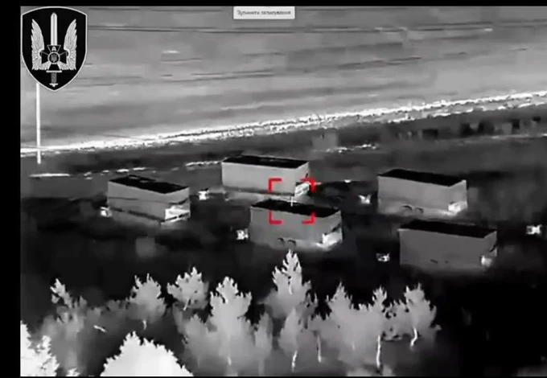

# > Introduction d'IRIS²
IRIS² est une constellation de 348 satellites, 330 en orbitasse basse et 18 en orbite moyenne. Les opérateurs sont SpaceRISE - SES, Eutelsat, Hispasat. Elle est analogue de Starshield.
Je la comprend comme un système de surveillance et relai militaire qui assure une connectivité constante entre tous les états de l'Union Européenne sur Terre, dont les territoires d'outre-mer, ambassades, avions en vol, navires en mission, drones et groupes de drone, 
Pour le moment IRIS2 n'existe pas et ce jusqu'en 2029, donc l'Allemagne actuel paye pour Starshield. 
# > Volna Kupol-Garant et systèmes anti-satellites
La Russie a produit en masse le Volna Kupol-Garant en réaction à Starlink en Ukraine ; systèmes de guerre électronique spécifiquement conçus pour contrer et perturber les constellations Starlink et Starshield de SpaceX. Une fois IRIS2 introduit aux Ukrainiens, il sera facile à la Russie de reprogrammer le Volna Kupol-Grant contre IRIS2.

Selon des rapports des services de renseignement occidentaux, la Russie travaille également sur des projets de guerre antisatellite (ASAT) beaucoup plus destructeurs dans l'espace.  Tel que des armes à fragmentation : Projets d'armes spatiales capables de générer des nuages de débris (shrapnel) en orbite basse pour détruire physiquement ou endommager les essaims de satellites.  
Je suis certain qu'en interne vous avez évalué les probabilités d'un syndrome de Kessler, donc vous savez aussi qu'on plus on monte dans les orbites les plus hautes, au plus le Syndrome de Kessler est peu probable.

Ainsi, pour éviter de pris de cours en 2035, quand IRIS2 aura 200 satellites en orbite basse, et que la Russie décide de tirer des armes à fragmentations.

Pourquoi la Russie ferait ça ? Putin ne réfléchit pas de manière rationnelle et économiquecomme un Chinois mais a une philosophie martiale du 19ème siècle - ce qui a le plus de valeur selon Putin c'est prendre du terrain et empêcher son voisin de s'étendre. 

À la sortie du Covid, la Russie a fait une erreur stratégique majeure - elle avait toutes les cartes en main pour se positionner en tête de la technologie juste derrière les Américains et Chinois. Elle aviat une population éduquée et très forte en math et en informatique, les matières premières pour construire les datacenters ainsi le climat nécessaire pour les refroidir naturellement.
La Russie avait les ressources pour développer des datacenters massifs alimentés par l'électricité russe par cher ; les Américains et les Chinois se battant dans la guerre à l'IA auraient pu alors acheter massivement du _compute_ aux Russe et la Russie aurait profité. 

Au lieu de ça, Putin a voulu grapillé quelques provinces dans le Donbas, et dans le même temps a réveillé l'Europe de sa torpeur et a forcé une accélération technologique militaire définissant aujourd'hui qu'est-ce que la guerre non-nucléaire au 21ème siècle : des drones et sous-marins avec une antenne Starlink et pilotés dans une cave à distance des tanks avec filets anti-drones, des champs de tranchées couverts de microfibres et malgré tout des sacrifices humains importants.

L'ambition de la Russie actuelle consiste donc à empêcher les autres de gagner, contrairement à l'Europe et la Chine développer ses proches technologies équivalentes. Ce n'est pas la meilleure stratégie mais c'est la stratégie de la Russie.

Le risque que la Russie utilise ses armes anti-satellites contre IRIS2 et ruine certaines orbites est extrêmement réel selon moi.
Il y a des précédents historiques sur d'usage de missiles anti-satellites par des pays sur leur propre satellite.

Si la Russie décide de monter une armada d'ASAT (ce qui est largement dans ses capacités), elle pourrait décider de décimer en quelques jours une partie d'IRIS2 en réaction à une action de l'Ukraine.
Cela ne déclencherait pas de guerre nucléaire pour des raisons pragmatiques (Mutually Assured Destruction (MAD)) et historiquement connues. 

Ce serait simplement les nouvelles règles du jeu et les opérateurs de satellite devraient alors s'adapter.

Le premier avantage est le volume : SpaceX est capable de s'adapter très rapidement grâce à l'incroyable volume de satellites du Starship.
Même en perdant momanténemnt l moitié de Starlink, avec les ports spatial depuis le Texas et la Louisiane, SpaceX serait capable de reconsistuer sa flotte en quelques mois.
SpaceX serait capable d'adapter ses satellites pour qu'ils fassent davantage de manoeuvres d'évasion de débris, voler sur de plus hautes orbites moins vulnérables.

Je pense qu'à terme SpaceX, avec le Starship et l'intégration verticale de Starlink/Starshield, pourrait accepter une durée de vie plus courte pour ses satellites en orbite basse (> 1 an) pour combattre un syndrome de Kessler déclenché par une surpopulation de l'orbite basse et l'usage accru de missiles anti-satellites dans tous les conflits mondiaux impliquant des drones se connectant par satellite.
C'est les avantages compounding d'une statégie de masse.

En biologie évolutive, on appelle ça une stratégie de reproduction r versus une statégie de reproduction K.
Historiquement, toutes les constellations de Satellite avait une stratégie de reproduction K car un seul satellite était un joyau unique qui coûtait très cher à fabriquer.

Désormais avec Starship et le stack industriel derrière Starlink, en orbite basse SpaceX peut se permettre une statégie de reproduction r : comparable à ces poissons qui lâchent des centaines d'oeufs dans l'Océan et accepte que seul un pourcentage ne survive jusqu'à l'âge adulte.

Le second avantage est l'écosystème SpaceX lui-même ; SpaceX est devenu un écosystème antifragile car chacune des élements majeurs de SpaceX produisent et nourrissent les autres élements au sein de l'écosystème. 
### > De l’intégration verticale à l’essaimage industriel : l’exemple de Castelion
L’avantage de SpaceX dépasse les activités que l’entreprise possède directement. Il existe aussi dans les compétences, les méthodes de production et les équipes qui peuvent essaimer vers d’autres entreprises. [Castelion](https://www.castelion.com/), fondée en 2022 par trois anciens de SpaceX, illustre cette diffusion : appliquer le développement rapide, les essais fréquents et la conception pour la fabrication en série à des armes hypersoniques dont le coût et les volumes de production constituent des enjeux militaires.

Il faut distinguer cette filiation industrielle d’une relation opérationnelle. Les informations publiques ne permettent pas de présenter Castelion comme une filiale de SpaceX, un fournisseur établi de Starshield ou un fabricant d’intercepteurs spatiaux destiné à protéger la constellation. La complémentarité possible se situe à l’échelle des forces armées : des infrastructures spatiales fournissent des observations et des communications, tandis que d’autres industriels fournissent les moyens d’action. Leur intégration relève du client militaire et ne suppose pas une propriété commune.

Pour l’Europe, la leçon serait de faire d’Aerospacelab un foyer de compétences industrielles dont les effets dépassent ses propres satellites. Une entreprise capable de produire des plateformes en série peut contribuer à former des équipes, qualifier des fournisseurs et diffuser des méthodes utiles à d’autres programmes européens.

Un « Castelion européen » serait donc, au sens strict, une entreprise indépendante qui transpose cette expérience à la production de systèmes de défense abordables et disponibles en quantité. Sa justification serait un besoin militaire et industriel identifié ; elle ne découlerait pas automatiquement de la nécessité de protéger IRIS².

Dans le domaine spatial, le même mécanisme d’essaimage pourrait concerner les terminaux, les communications optiques, la surveillance de l’environnement orbital ou les services de maintenance et de renouvellement des constellations. Ces activités ne seraient pas des équivalents techniques de Castelion, mais des applications de la même logique industrielle.

L’objectif serait ainsi de combiner une intégration verticale sélective chez Aerospacelab avec un réseau d’entreprises autonomes capables de servir plusieurs clients. L’autonomie européenne dépendrait alors d’une capacité collective à produire, adapter et remplacer ses infrastructures, sans exiger qu’une seule entreprise maîtrise toute la chaîne.

# > Différente statégie pour Aerospacelab 
Aerospacelab ne bénéficie cette décennie et la décennie prochaine d'aucun de ces deux avantages et ne peut donc pas se permettre de perdre des satellites. 
Pour se préparer aux très probables ASAT russes, je suggère de créer deux espèces de satellites différentes. Une espèce de satellite en orbite basse, optimisé purement pour la production de masse avec une durée de vie moins longue, et une espèce satellite pour orbite MEO avec une durée de vie plus longue. 
Je suggère aussi d'augmenter le nombre de ces satellites en orbite moyenne - hors de portée des armes russes car d'ici 2040 il est possible que seuls eux restent plus d'1 an en orbite.

Enfin pour rester discret et se détacher d'IRIS2 si la constellation venait à être une cible des Russes ou même de la Chine, je propose de présenter Aerospacelab comme un simple contracteur semi-indépendant dans les médias.
Elon Musk n'a pas de chance a ce niveau-là car les médias et l'esprit des gens ont beaucoup de mal à faire la distinction entre Starlink et Starshield, et ce nommage aussi similaire a peut-être été une erreur.

La discrétion est un avantage ici : Aerospacelab a tout intérêt à laisser les gros contracteurs OldSpace (Thales/Leonardo/Airbus et l'EU elle-même) se jetter des lauriers pour IRIS2 - tout en continuant à augmenter son intégration verticale en arrière plan. Si la Russie venait à frapper IRIS2 en orbite basse, Aerospacelab pourrait maintenir sereinement des satellites en orbite basse en parallèle.

Aerospacelab pourrait tenter de devenir un NVIDIA du spatial Européen. Sur la même logique, il n'y aurait pas non plus de lanceurs Aerospacelab mais des lanceurs sous un autre nom, entièrement fabriqués en Megafactory par Aerospacelab.

Les gens dans les médias ne sont pas toujours intéressés par la vérité mais davantage par le sens narratif, il faut en tirer profit.
