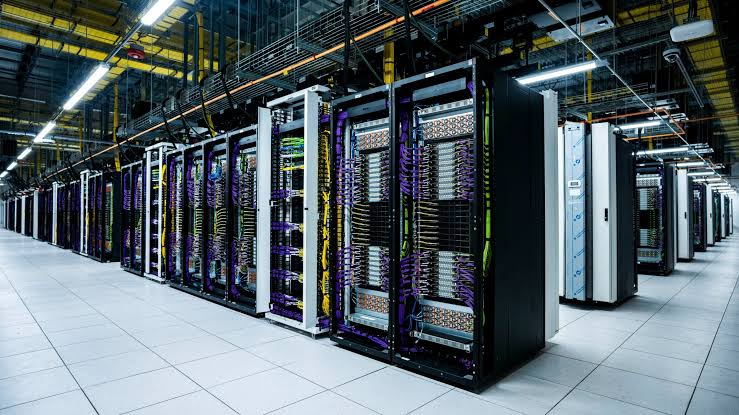

Un satellite est un ordinateur conçu pour l'espace. Un data center orbital est un assemblage modulaire d'ordinateurs conçus pour l'espace.

Je suis probablement biasés par ma pensée de développement de systèmes et les centaines d'heures que j'ai passé à me renseigner sur Starlink et le complexe industriel de SpaceX et SpaceXAI - mais je vois les data centers orbitaux comme une inévitabilité.
Cette inévitabilité a encore plus de sens en Europe qu'aux États-Unis puisque notre marché de l'énergie et les politiques de décroissance européenne ne permettent pas un scaling aisé de data centers terrestres pour l'intelligence artificielle.

Les data centers n'ont pas besoin d'être une orbite basse, on peut utiliser des orbites très éloignées jusqu'à 0.8-1 sec de délai pour des get et des push en asynchrone.
D'ailleurs c'est beaucoup mieux car imaginons un scénario de début de Syndrome de Kessler avec la compéttion sur orbite basse, nous voulons dans ce scénario toujours garder nos datacenters en sécurité sur des orbites que nous considérons pour le moment comme des orbites "parking". Je trouve les orbites plus hautes terrestres sont sous-utilisées or elle se prêtent bien à ce type de usecase.

Quels sont les bottlenecks d'avoir des data center européens en orbite 
1er bottlneck : Le lanceur
2eme bottleneck : Ou produire ces data centers
3eme bottleneck : Production des chips et chaine de production des semiconducteurs.
Si nous devions reconstituer toute la chaine de production en Belgique en 2050 comment ferait-on ? Alors permettez-moi d'être créatif mais quand je suis allé au Startup Show de Charleroi le 8 Octobre, j'ai découvert Vertical Compute qui travaille en collaboration avec l'IMEC. Le bottleneck de Vertical Compute c'est la fabrication des wafers. Je propose ceci : pousser l'intégration verticale d'une Megafactory d'Aerospacelab tellement loin qu'Aerospacelab vient à produire des wafers pour l'industrie du semiconducteur belge, en les envoyants à Vertical Compute pour être gravé, IMEC, ASML EUV lithography machine pour être gravé, puis revenant à Aerospacelab pour l'assemblage du GPU, enfin.
Ce que je dis semble impensable avec notre cerveau de 2025 car la chaine de gabrication des semiconducturs suit un parcours bien connu qui va de ASML (pays bas) => TSMC (taiwan) => AMD, Intel pour les CPU et NVIDIA pour les GPU => différents marchés. La Chine est pour le moment en train d'essayer d reproduire / intégrer verticalement cette chaine in-house un maximum et ils réussiront - et le plan officiel du CCP est d'intégrer Taiwan par la force. La chaine de production des semiconducteurs est vouée à se diversifié de cet axe dans la prochaine décennie. Cette année, Musk s'est lancé le pari fou de tenter également de produire ses propres puces via Terafab, qui a déjà énormément de clients intéressés.
Il ne me parait pas improbable qu'à terme les chaines de production de semiconducteur soient décentralisées et que beaucoup de pays tente de l'intégrer au maximum chez eux. La Belgique parait fort féconde à cette idée. D'ailleurs IMEC à Louvain est en réalité là où se moment se créer le futur des semiconducteurs et une organisation extrêmemnt sous-côté et pourtant fondatrice et indispensable à ASML, comme le montre cette vidéo : [imec — the most important company you've never heard of](https://www.youtube.com/watch?v=hDo5P578wJI) 
Aerospacelab pourrait ensuite assembler ses ordinateurs en de gros satellites, et les envoyer sur orbite via leur lanceur de 2ème ou 3ème génération. Faisable selon moi d'ici 2040 compte tenu des avancements dans l'IA et l'intégration des systèmes. Je pense que ce sera même une nécessité pour resté à niveau face aux USA et la Chine qui ne nous attendront pas.

L'avantage des Data centers orbitaux est que toute leur énergie vient de l'espace. Je m'inquiétais que les satellites ne puissent pas avoir de radiateurs pour se refroidir mais l'un de vos collaborateurs m'a rassurer que c'était faisable.
À terme le compute orbital sera moins cher que le compute terrestre, donc si ce n'est pas trop tard (et ça ne l'est pas) autant se placer sur ce marché le plus tôt possible dans un futur monde d'agents toujours plus omniprésents.