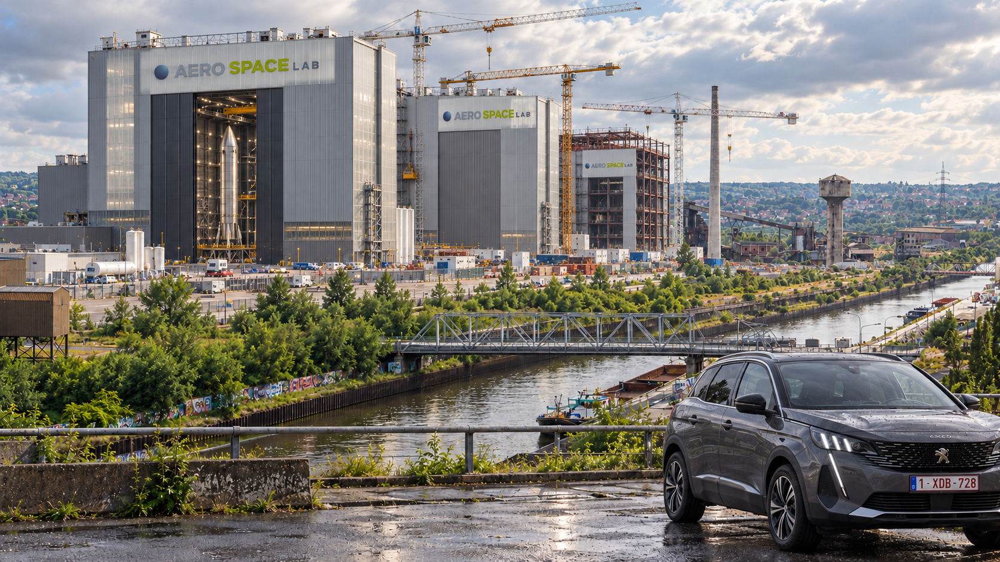

Aerospacelab est désormais rentable d'elle-même et donc nous pouvons nous projeter dans la stratégie long terme plus sereinement. J'ai passé une partie de la fin des années 2010s et le début des annés 2020s à me renseigner comment aux États-Unis le Newspace a remplacé le OldSpace. Donc je suis très fan de la stratégie d'Aerospacelab de remplacer le OldSpace Européen Thales-Leonardo-Airbus.
Pour pouvoir délivrer l'Europe des preuves sur une fonction d'échelle similaire à SpaceX, il nous faut pas de vieux contracteurs mais une nouvelle compagnie comme Aerospacelab qui prend certains risques et produit des satellites à bas coût mais puissants, puis une compagnie qui fait de même pour les lanceurs.
C'est le seul moyen pour l'Europe d'avoir une indépendance militaire et en cyberguerre. En délivrant d'IRIS2, Aerospacelab se positionne déjà comme équivalent partiel du service Starshield de SpaceX.

Côté lanceur, je ne peux pas savoir les projets internes, mais Isar Aerospace me semble proche du type de lacuer New Space que vous aimeriez avoir. À l'exception qu'au lieu de lancer depuis la Norvège, qu'est-ce qui empêche la faisabilité de lancer depuis les Canaries ou les Açores. Une alliance pragmatique avec l'Espagne ou le Portugal pourrait être intéressante - Aerospacelab offre la technologie et l'intégration verticale, et le Portugal offre le terrain pour le port de lancement et la gestion des lancements sur place aux Açores. La France étant déjà le règne maître du spatial Européen avec le Port de Kourou en Guyane offrat un très faible degré d'inclinaison orbital, on ne voudrait pas concentrer trop de pouvoir spatial au sein du gouvernement français. 
Imagions un instant que la Belgique fasse un partenariat avec l'Espagne et lance un mini-Starship depuis les Canaries sur un orbite à 30°-40°, le bottleneck d'Aerospacelab serait retiré.
Beaucoup vous dirons que c'est impossible, mais rien n'est fondamentalement impossible surtout aujourd'hui avec la puissance de l'IA + intégration verticale + nécessités réelles de l'Europe.

Avoir des lanceurs st inévitable pour Aerospacelab dans sa starétgie de NewSpace qui s'intègre verticalement, surtout avec l'abandon des Rideshares par SpaceX (avec la retraite progressive de la Falcon 9) comme vous l'aviez expliqué dans notre conversation du 6 octobre.

Mais est-ce qu'Aerospacelab peut aussi s'attaquer à Ariane ? Le bottlenck principal de l'Europe c'est Ariane. 
En Chine il y a une entreprise qui s'appelle _Space Epoch_ et fabricatur de moteur qui s'appelle [Jiuzhou Yunjian](https://en.wikipedia.org/wiki/Jiuzhou_Yunjian "Jiuzhou Yunjian") et développe une fusée similaire au Starship au format réduit, avec un moteur methane-LOX similair au Raptor, des réservoirs en inox et le tout dans un design itératif.

En fait je pense même que la retraite de la Falcon 9 et des rideshares est une opportunité pour le marché du New Space Européen autant côté lanceur que satellite, car il peut enfin pleinement se développer dans sa niche - SpaceX poursuivant majoritairement ses propres buts internes et de plus en plus indépendant du reste de l'industrie aérospatial et des satellites. Qui sait, une fois le nouveau lanceur fonctionnel, pour moi cela mènera inévitablement à un équivalent de la Crew Dragon en Europe. Par quel entreprise il sera développé, par-contre je l'ignore. 
Une question que je me pose c'est est-ce Starfall représente un concurrent direct pour le marché des microsats types Aerospacelab ? Starfall est une sorte de remplacement de Rideshare

Je pense que le positionnement d'Aerospacelab comme acteur incontestable peut se faire sur une durée plus courte d'attendue, par exemple d'ici 2036. Prenons toujours comme exemple SpaceX. En 2015, SpaceX atterit pour la première fois le premier étage de la Falcon 9 et faisait $1 milliard de CA. Aujourd'hui fin 2026, SpaceX fait basculer tout ses lancements Starlink sur son lanceur super-heavy-lift et entièrement réutilisable Starship (impensable il y a 13 ans) et fait $14B de CA. Starship coûte en développement annuel moins d'un SLS par an. Il n'y a que 11 ans de différence pour ces deux états radicalement différents de pourtant la même entreprise.
# Gigabays en Wallonie, Pad de lancement aux Canaries
Transporter par voie fluviale des fusées entières
# Starbase
J'ai passé pas mal de temps à suivre les Megabays de SpaceX
