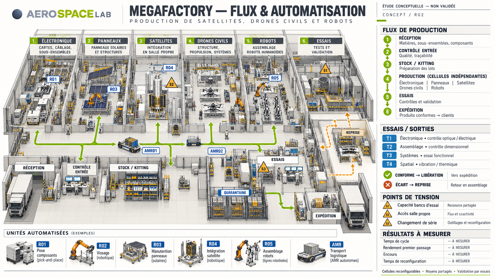
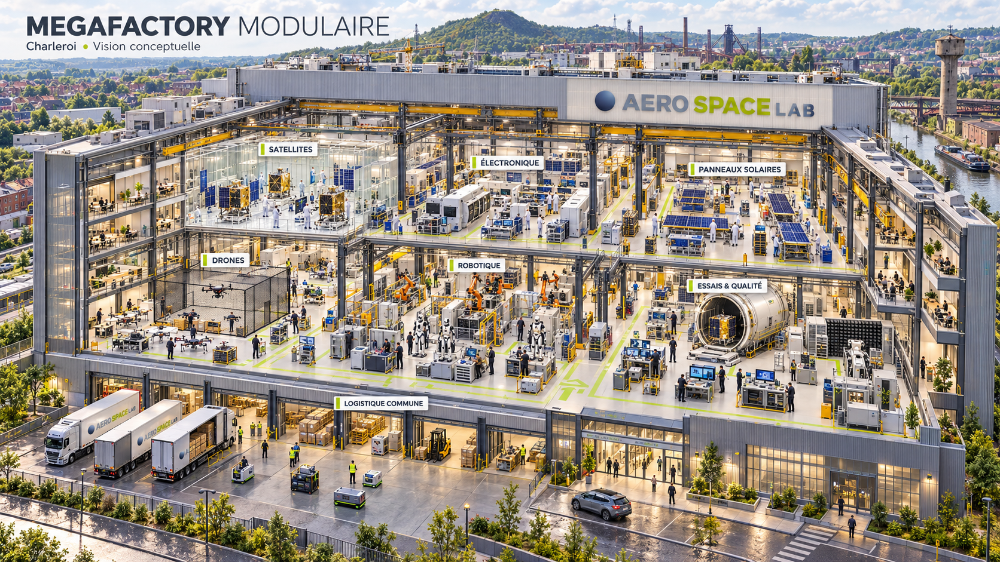

L'intégration verticale et la pivotabilité de la Megafactory se renforcent mutuellement.
Imaginons que soudainement il n'y ait plus besoin de produire un satellite upar jour, l'intégration vrticale au sein de la Megafactory doit pemrettre de produire massivement directement des éléments de systsème : panneaux solaires, drones, assemblage d'électronique en fonction des besoins.

Aerospacelab agit alors bien moins comme un contractuel spatial classique mais comme un cellule industrielle s'adaptant facilement au besoin de son environnement pour survivre, se dépasser et rester utile. Réalistiquement d'ailleurs, les demandes vont fluctuer. Pendant 3 mois il va peut-être y avoir une grosse demande pour des satellites VSP, puis les 3 mois suivants ce sont davantage des antennes et des drones de différents types spécifiques qui seront demandés. Cette faculté se posera de plus en plus au fur et à mesure qu'Aerospacelab se rendra indispensable à la Défense Européenne.

Je pense d'ailleurs que le tissu urbain de Charleroi est parfait pour construire plusieurs Megafactory, il y a plusieurs terrains inutilisés pourtant bien dessrvis par des autoroutes, historiquement industriel, et l'urbex est prêt à faire place à une nouvelle couche économique moderne et automatisée.
### >Robotique industrielle
Une megafactory peut aussi être pivoté et restructurée pour fabriquer des robots en masse si nécessaire, pas juste des drones. Implanter un agent multimodal opensource dans un robot et l'entrainer dans un simulateur pour qu'il s'adapte à son nouveau corps est devenu réalisable en quelques mois. Si le besoin viendrait, je pense qu'une megafactory est capable de prendre en charge la production de robots. L'avantage est clair pour l'Europe : se détacher de la dépendance de robots américains (telles que Figure et Optimus) et de la puissance industrielle Chinois. D'un point de vue marketing également, produire des robots belges est intéressant.

